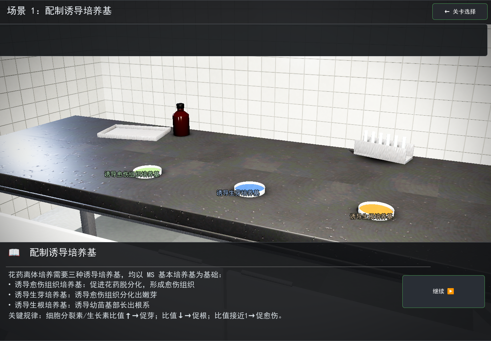

# Scene 1 写实化说明

样板关「配制诱导培养基」的写实化改造记录。目标是「科教纪录片感」的实验室台面：
瓷砖墙、深色环氧树脂台面、三只装着不同培养基的培养皿。

渲染后端是 `gl_compatibility`（Android 导出需要），**没有 SSAO / SSR / 景深 / 体积雾 / 真透射**，
所以真实感要靠几何比例、材质粗糙度、布光和取景撑起来，不能指望后处理。



---

## 1. 资产管线

```
blender/build_textures.py   →  assets/textures/*.png（程序化 PBR：albedo + normal）
blender/build_props.py      →  assets/props/*.glb（建模并导出）
scripts/Scene1.gd           →  运行时按节点名覆盖材质
```

重新生成：

```bash
python3 blender/build_textures.py
/Applications/Blender.app/Contents/MacOS/Blender -b --python blender/build_props.py
/Applications/Godot.app/Contents/MacOS/Godot --headless --import --log-file .logs/imp.log
```

> **改完 GLB 必须重新 import。** Godot 跑游戏时读的是 `.godot/imported/` 的缓存，
> 不 import 会一直用旧模型（这个坑踩过：模型改了、画面完全没变）。

贴图用 numpy + Pillow 程序化生成，固定随机种子，可重复。
纹理法线图在 `.import` 里设了 `compress/normal_map=1`。

## 2. 关键约定

| 项目 | 约定 |
| --- | --- |
| 单位 | 米。培养皿 Ø92 mm × 高 18.5 mm，台面 2.4 × 0.75 × 0.90 m |
| 朝向 | Blender **−Y 是正面**（正面视图方向），导出后对应 Godot **+Z**；背景墙放 **+Y** |
| UV | 建模后按世界坐标做盒式投影（`apply_world_uv`），1 世界单位 = 1 UV 单位 |
| 原点 | 都在物理底面，方便直接摆到 `BENCH_TOP_Y = 0.9` |
| 节点名 | `dish_bottom` / `dish_lid` / `agar` / `bench_top` / `bottle_body` / `tube_` …，脚本靠**前缀**匹配覆盖材质 |

朝向这条是硬伤级别的：glTF 导出把 Blender 的 +Y 映射到 Godot 的 −Z。
第一次建模把「正面」和「背景墙」都放在 +Y，结果墙跑到相机背后、实验台背对镜头，
画面里看到的「灰墙」其实是越过台面的地板。

UV 那条同理：Blender 立方体默认 UV 是十字布局，每个面只占 1/4 UV 空间，
直接用会让贴图被放大 4 倍（瓷砖变成 40 cm 一块）。改成世界盒式投影后，
材质里的 `uv1_scale` 才有可预期的含义：**贴图覆盖多少米 = 1 / uv1_scale**。

## 3. 场景参数

```gdscript
const BENCH_TOP_Y := 0.9
const DISH_X := [-0.36, 0.0, 0.36]
const DISH_Z := 0.18            # 靠近台沿，画面里更大、更像随手摆的
const CAM_POS := Vector3(0.50, 1.40, 1.30)   # 略偏右的 3/4 机位，避免正对
const CAM_TARGET := Vector3(-0.05, 0.93, 0.10)
const CAM_FOV := 41.0
const CAM_BREATH := 1.0         # 极轻微的呼吸感
```

布光（`_setup_lighting`）：

| 灯 | 作用 | 能量 |
| --- | --- | --- |
| 主光 Directional −46°/34° | 明暗结构，唯一投影 | 0.95 |
| 冷补光 Directional −12°/−125° | 压暗部 | 0.30 |
| 墙面洗光 Directional | 照亮背景瓷砖 | 0.07 |
| 轮廓 SpotLight | 勾皿口与台沿 | 2.6 |
| 前景 Omni | 台面与器皿提亮 | 0.45 |
| 顶灯 Omni + 自发光灯管 | 室内光比 | 0.60 |
| 光池 SpotLight（正上方 58°） | 在台面压出一片明暗梯度，深色台面才不是死黑 | 2.4 |

环境：`BG_COLOR` + `AMBIENT_SOURCE_COLOR`（0.45），ACES，曝光 1.0，轻 glow。

**不要用程序化天空。** `gl_compatibility` 下 `BG_SKY` + `ProceduralSkyMaterial` 会退化成黑场，
而且 `AMBIENT_SOURCE_SKY` 一并失效——上半屏纯黑、竖面全没光。

## 4. 材质上的三个坑

1. **玻璃**：Compatibility 没有 transmission，也不支持屏幕折射。
   用 alpha 混合做玻璃，在掠射角会因 Fresnel 高光整片变白——10% 的 alpha 也能把培养皿糊成一个白瓷杯。
   现在的做法：培养皿壳体用不透明的浅色聚合物（`dish_shell.tres`），靠白色薄壁读出皿口，
   颜色交给琼脂本身；烧杯才用真 alpha 玻璃（`specular_mode = 2` 关高光）。
2. **琼脂**：颜色不能靠贴图，贴图接近白色，颜色全靠 `albedo_color` 乘上去。
   为了在强光下仍能区分绿 / 蓝 / 琥珀，用 `Color.from_hsv(h, s * 1.45, v * 0.72)` 提饱和、压亮度。
   高光必须低（`metallic_specular = 0.15`），否则表面一片白，颜色全丢。
3. **金属**：没有环境反射时 `metallic = 1.0` 会发黑。不锈钢降到 0.55、粗糙度 0.30。

## 4.5 接触阴影与陪衬道具

`gl_compatibility` 没有 SSAO，器皿与台面之间没有暗角，看起来像「贴」上去的。
做法是给每个立着的物体脚下一张 **假接触阴影贴图**（`contact_shadow.png`，
中心不透明、边缘柔化的径向暗斑，unshaded 材质贴在台面 0.8 mm 上方）。
便宜、可控，比等 SSAO 现实。

道具（`blender/build_props.py`）：

| 文件 | 内容 | 摆位 |
| --- | --- | --- |
| `petri_dish.glb` | 皿身 + 皿盖 + 琼脂，Ø92 mm | 三联，`DISH_Z = 0.18` 靠台沿 |
| `lab_bench.glb` | 台面 + 滴沿 + 柜门 + 架体 | 原点 |
| `lab_tray.glb` | 不锈钢器械盘 | 左后 |
| `reagent_bottle.glb` | 100 mL 棕色瓶 + 黑盖 | 左后，压在托盘旁 |
| `tube_rack.glb` | 6 孔试管架 | 右后 |
| `beaker.glb` | 烧杯（真 alpha 玻璃） | 台面右端，多数机位在画外 |
| `lab_room.glb` | 瓷砖墙 + 地板 + 踢脚 | 场景整体 |

陪衬道具的作用是**压住空台面**并给出前后层次（皿在前、道具在后、墙在最后），
不是为了炫技——没有它们，画面就是「三个圆片摆在一块黑板上」。

## 5. 标签

皿名标签用的是 **2D UI 投影**，不是 `Label3D`：

```gdscript
var screen := camera.unproject_position(world)
tag.position = screen - tag.size * 0.5
```

`Label3D` 在近距离会被深度裁切成重影、远处又糊，字号与像素尺寸怎么调都不稳。
2D 投影标签在任何距离都是原生分辨率，清晰可读，还自带描边。

## 6. 回归验证

截图（独立工具，不侵入游戏脚本）：

```bash
/Applications/Godot.app/Contents/MacOS/Godot --path . res://tools/capture.tscn \
  --log-file .logs/cap.log -- --scene res://scenes/Scene1.tscn --out res://docs/shots/x.png --wait 45
```

`--dump` 打印场景树（节点名 / 材质 / 位置 / 可见性），排查资产问题很快。

交互回归（点击、配方判定、步骤推进、错误配方拒绝）沿用原有逻辑，本次只改渲染与标签，
`_define_steps` / `_on_formula_chosen` / `_pulse_matched` / `_update_progress` 未改动。

## 7. 已知限制

- 无 SSAO：器皿与台面之间没有接触暗角，靠投影灯勉强补，贴得近时会显得「贴上去」。
- 无景深：背景墙和前景一样实，纪录片那种浅景深只能靠构图规避。
- 无真透射：玻璃只能用「不透明壳体 + 低高光」近似。
- 墙面纯白瓷砖在强光下容易顶到 255，靠 `albedo_color` 压到 0.80 控制。
- 目前只有 Scene 1 做过写实化，其余 6 关仍是原版 primitive 搭的方块场景。
